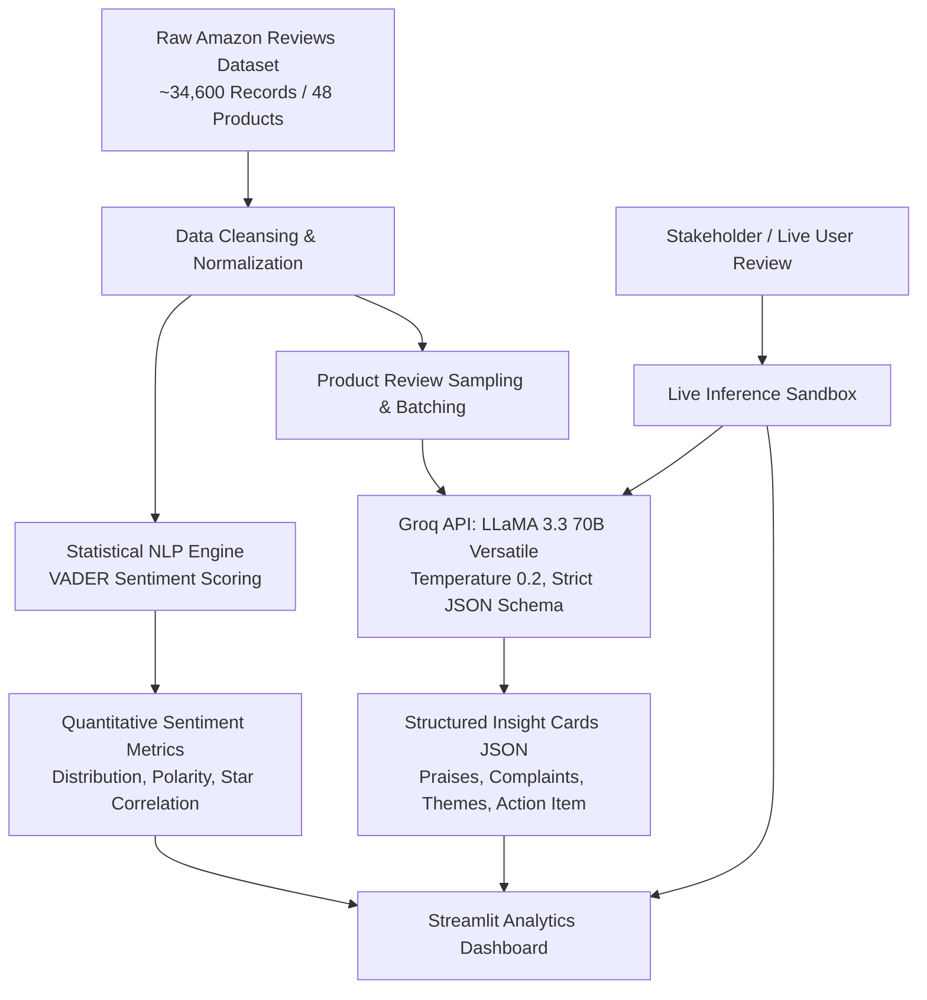

# Customer Feedback Analysis Dashboard

[](https://www.python.org/)
[](https://streamlit.io/)
[](https://plotly.com/)
[](https://groq.com/)
[](https://github.com/cjhutto/vaderSentiment)
[](LICENSE)

**InsightForge**: A GenAI-powered customer feedback intelligence platform and sentiment analytics dashboard. Transforms raw, unstructured customer product reviews into structured, actionable intelligence—combining high-throughput classical sentiment analysis (VADER) with generative LLM reasoning (LLaMA 3.3 70B via Groq) and an interactive Streamlit visualization suite.

---

## 1. Executive Summary

Product managers, customer experience teams, and data analysts cannot manually read through tens of thousands of customer reviews per product SKU. Traditional sentiment tools assign a single polarity score, losing critical nuances, while manual inspection is impossible at scale.

**Customer Feedback Analysis Dashboard** provides an automated dual-layer intelligence pipeline:
1. **Quantitative Baseline (VADER)**: Computes polarity scores across 34,600+ reviews instantaneously, benchmarked against star ratings to establish statistical baselines.
2. **Qualitative GenAI Layer (LLaMA 3.3 70B via Groq)**: Extracts structured JSON insight cards detailing **Top Praises**, **Critical Complaints**, **Recurring Product Themes**, and a concrete **Recommended Engineering/Product Action**.
3. **Interactive Visual Dashboard**: A Streamlit application allowing stakeholders to explore product sentiment, compare quantitative metrics against LLM summaries, and run live real-time analysis on custom user feedback.

---

## 2. Architecture & Pipeline



### Pipeline Breakdown:
1. **Data Preprocessing**: Filters missing ratings and incomplete text, strips HTML artifacts, and normalizes product names across diverse hardware product lines (e.g., Fire tablets, Echo smart speakers, Kindle e-readers).
2. **VADER Sentiment Scoring**: Assigns continuous compound polarity scores $(-1.0 \text{ to } +1.0)$ and validates calibration against user-assigned 1-to-5 star ratings.
3. **GenAI Product Insights**: Samples stratified reviews per product and prompts LLaMA 3.3 70B using strict JSON output formatting.
4. **Interactive Dashboard**: Provides product comparison cards, dynamic Plotly distribution charts, and real-time live review classification.

---

## 3. Key Features

- **Dual Sentiment Validation**: Compares quantitative VADER polarity directly with LLM qualitative sentiment assessment.
- **Structured Actionable Insights**: Synthesizes unstructured customer feedback into:
  - Top 3 recurring praises
  - Top 3 critical defect / complaint areas
  - Core recurring themes
  - One high-impact recommended operational action
- **Real-Time Live Review Sandbox**: Paste any raw review text to instantly extract sentiment, a one-line summary, and key bullet points via Groq inference.
- **Offline Fallback Mode**: Gracefully operates even without an API key using pre-computed insight caches and frequency-based fallbacks.
- **Interactive Visualizations**: Plotly histograms, bar charts, and filtered tabular data explorers.

---

## 4. Project Structure

```
customer-feedback-analysis-dashboard/
├── app/
│   └── dashboard.py                 # Interactive Streamlit analytics application
├── data/
│   └── amazon_reviews.csv           # Raw customer review dataset (~34.6k reviews)
├── notebooks/
│   └── genai_insight_tool.ipynb     # Jupyter notebook with end-to-end pipeline execution
├── outputs/
│   ├── product_insight_cards.json   # Generated structured LLM insight cards per product
│   ├── product_sentiment_summary.csv# Aggregated product-level sentiment statistics
│   └── reviews_with_sentiment.csv   # Enriched reviews with computed VADER scores
├── .env.example                     # Environment template for Groq API key
├── .gitattributes                   # Git line-ending normalization
├── .gitignore                       # Ignored artifacts, virtual environments, cache files
├── requirements.txt                 # Python dependencies
└── README.md                        # Master documentation
```

---

## 5. Technology Stack

- **Language & Core**: Python 3.10+, Pandas, NumPy
- **Classical NLP**: VADER Sentiment (`vaderSentiment`)
- **LLM Engine**: Groq Cloud API (`llama-3.3-70b-versatile`) via OpenAI-compatible client
- **Dashboard UI**: Streamlit
- **Data Visualization**: Plotly Express, Matplotlib, Seaborn
- **Exploratory Analysis**: Jupyter Notebook

---

## 6. Getting Started

### Prerequisites
- Python 3.10 or higher
- (Optional but recommended) Free Groq API Key from [Groq Console](https://console.groq.com)

### Installation

1. **Clone the repository:**
   ```bash
   git clone https://github.com/ashok9847/customer-feedback-analysis-dashboard.git
   cd customer-feedback-analysis-dashboard
   ```

2. **Create and activate a virtual environment:**
   ```bash
   python -m venv venv
   # On Windows:
   .\venv\Scripts\activate
   # On macOS/Linux:
   source venv/bin/activate
   ```

3. **Install dependencies:**
   ```bash
   pip install -r requirements.txt
   ```

4. **Set up API Key (Optional for live LLM inference):**
   ```bash
   cp .env.example .env
   # Edit .env and insert your GROQ_API_KEY
   ```

---

## 7. Running the Application

### Launch the Streamlit Dashboard:
```bash
cd app
streamlit run dashboard.py
```
Open your browser at `http://localhost:8501` to explore the dashboard.

### Run the Jupyter Notebook Pipeline:
```bash
jupyter notebook notebooks/genai_insight_tool.ipynb
```

---

## 8. Sample Output Card

Below is an example of the structured JSON insight card produced for the **Fire HD 8 Tablet**:

```json
{
  "product_name": "Fire HD 8 Tablet, 8\" HD Display, Wi-Fi, 16 GB",
  "overall_sentiment": "positive",
  "vader_mean_compound": 0.74,
  "top_praises": [
    "Excellent value for money and affordable pricing",
    "Vibrant display quality and compact, portable form factor",
    "Great battery life for streaming video and reading"
  ],
  "top_complaints": [
    "Lock-screen advertisements require extra fee to remove",
    "Lack of native Google Play Store access",
    "Occasional lag during multitasking or heavy gaming"
  ],
  "recurring_themes": [
    "Kid-friendly entertainment and parental controls",
    "Amazon Prime video ecosystem integration",
    "Storage expansion via microSD"
  ],
  "recommended_action": "Improve base RAM configuration to reduce UI stutter and simplify sideloading parental controls."
}
```

---

## Author

**Ashok Aryal**
- GitHub: [@ashok9847](https://github.com/ashok9847)

---

## License

This project is licensed under the MIT License. See [LICENSE](LICENSE) for details.
